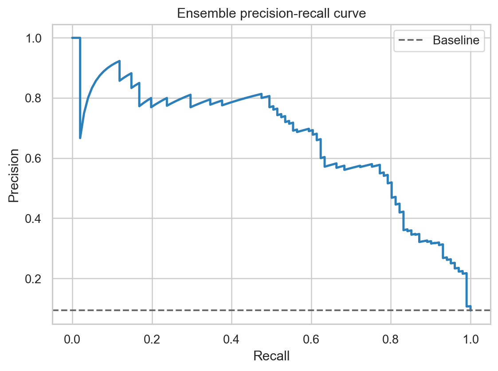
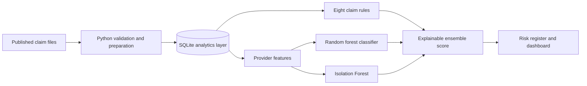
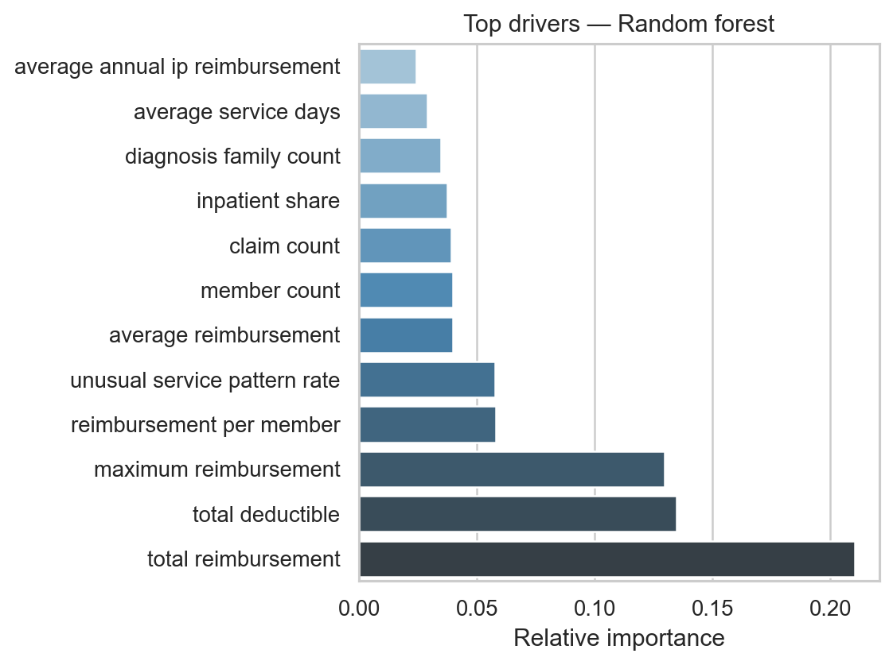
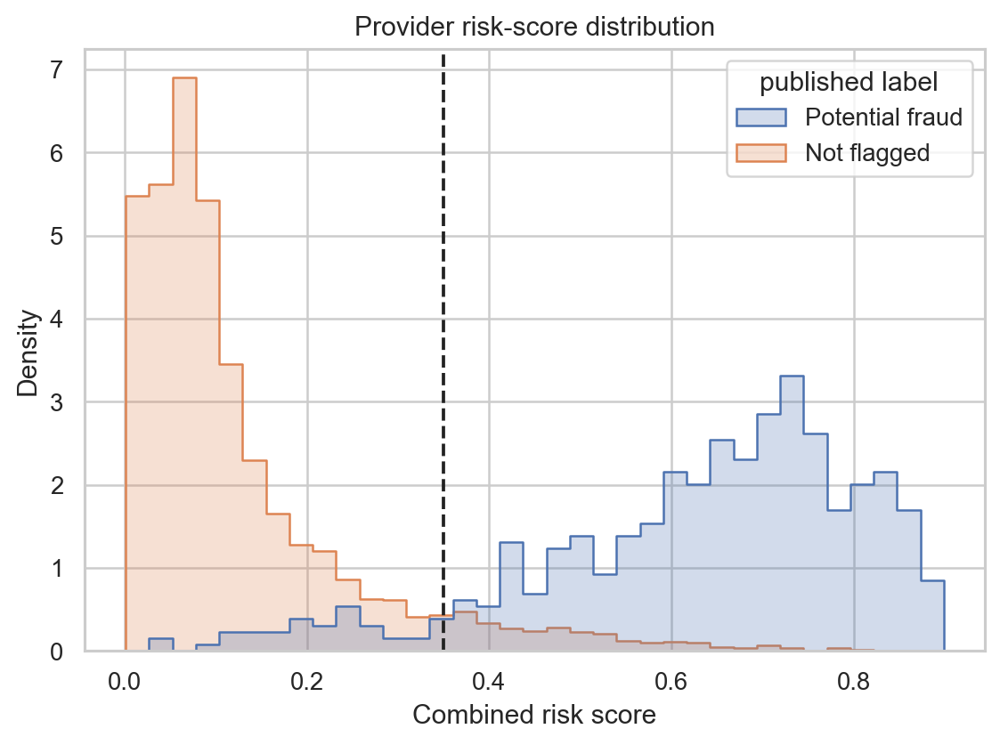

# Claims Risk and FWA Detection

Healthcare claims teams can receive far more cases than they can review manually. This project turns large volumes of claim records into a prioritized provider review queue, explains the main reasons behind each alert, and summarizes patterns involving payments, coding, duplicate activity and service utilization. The outputs help teams focus investigation time on higher-risk cases while keeping every final decision with a qualified reviewer.

- **Business solution:** rank providers by review priority and show the evidence contributing to each score.
- **Main insight:** a focused review group containing 16.8% of held-out providers captured 81.2% of the published potential-fraud cases.
- **Recommended action:** review High-risk providers first, validate the supporting claims and use confirmed outcomes to improve future thresholds and models.

[](https://www.python.org/)
[](https://www.sqlite.org/)
[](#reproduce-the-analysis)
[](https://doi.org/10.5281/zenodo.18138102)

An end-to-end healthcare analytics workflow combines transparent claim rules, supervised classification and unsupervised anomaly detection, then explains why each provider was prioritized.

## Outcome

The pipeline screened **558,211 claims** from **5,410 providers**. On an untouched provider-level test set, the combined risk score captured **81.2%** of labeled potential-fraud providers while reducing the review population to **16.8%** of providers.

| Held-out metric | Result |
|---|---:|
| Recall | **81.2%** |
| Precision | **45.1%** |
| F2 score | **0.700** |
| PR-AUC | **0.663** |
| ROC-AUC | **0.936** |
| Precision lift vs. 9.4% base rate | **4.8×** |

The operating point intentionally favors recall: missing a risky provider is treated as more costly than sending an additional case to an analyst.



## Business findings and actions

| Finding | Business meaning | Recommended action |
|---|---|---|
| 182 of 1,082 held-out providers entered the review queue | The team can investigate a smaller, prioritized group instead of screening every provider | Start with the High-risk tier and record the outcome of each review |
| Total reimbursement, deductibles and maximum reimbursement were the strongest model drivers | Financial exposure and unusually large billing patterns deserve early attention | Compare flagged providers with appropriate specialty and case-mix peers |
| Non-positive amounts, unusual service patterns, cost outliers and coding gaps were the most frequent rules | Alerts can arise from payment adjustments or process-quality issues as well as possible FWA | Separate recoverable errors, training needs and credible FWA referrals during review |
| False positives remain part of the operating model | A risk score supports prioritization; it is not evidence of intent | Require human validation before payment, recovery or provider action |

## What the workflow detects

- Exact duplicate claim patterns
- Repeated provider-member activity on the same service date
- Invalid service, admission or discharge date sequences
- Missing or inconsistent diagnosis and procedure information
- Reimbursement outliers against comparable claim groups
- Rare provider-service combinations
- Non-positive reimbursement amounts
- Missing attending-physician details
- Provider-level utilization, member, diagnosis-mix and cost anomalies

## How it works



The supervised candidate is selected on validation PR-AUC. Peer cost and service-frequency benchmarks are learned from training providers only. The review threshold is selected on the separate validation split using F2, then reported once on the untouched test split. This keeps reference fitting and threshold tuning out of final evaluation.



## Investigation output

The risk register separates the three evidence sources and provides plain-language review reasons:

| Field | Meaning |
|---|---|
| `supervised_probability` | Pattern similarity to providers carrying the published potential-fraud label |
| `anomaly_score` | Unusual provider behavior learned without labels |
| `rule_score` | Strength of transparent claim-rule signals |
| `risk_score` | Weighted investigation-priority score |
| `review_reasons` | Rules and influential provider features supporting review |

Use the included Streamlit workbench to filter High, Medium and Low risk tiers and inspect provider reasons.



## Reproduce the analysis

```bash
git clone https://github.com/mahssan750/claims-risk-fwa-detection.git
cd claims-risk-fwa-detection
python -m venv .venv
# Windows: .venv\Scripts\activate
# macOS/Linux: source .venv/bin/activate
pip install -r requirements.txt
pip install -e . --no-deps
claims-risk all
pytest -q
streamlit run dashboard/app.py
```

The `all` command downloads the four required source files, verifies their MD5 checksums, builds the SQLite layer, trains the models and recreates every published artifact. Raw data, the generated database and serialized models are excluded from Git.

## Data source

This project uses the public **Medicare Fraud Detection Dataset**, archived unchanged on Zenodo with DOI [10.5281/zenodo.18138102](https://doi.org/10.5281/zenodo.18138102). The analysis uses the labeled training files only:

- 517,737 outpatient claims
- 40,474 inpatient claims
- 138,556 beneficiary records
- 5,410 provider labels, including 506 marked `PotentialFraud = Yes`

The raw files are not redistributed in this repository. The label means **potential fraud**, not confirmed fraud, and may contain noise or historical bias.

## Repository guide

```text
src/claims_risk/       Download, preparation, modeling and reporting code
sql/                   Claim rules and provider feature engineering
dashboard/             Streamlit investigation workbench
tests/                 Behavioral and real-SQL rule tests
artifacts/             Reproducible metrics, charts and sample risk register
docs/                  Methodology, data dictionary and model card
```

## Responsible use

This is an investigation-prioritization demonstration, not a payment-denial or accusation system. A qualified reviewer should confirm coding, documentation, medical necessity, contractual rules and clinical context. Protected attributes are not used as model features. Results from synthetic or de-identified public data should not be treated as expected production performance.

## Author

**Mohamed Hassan Aboulabed** — Healthcare Data Analyst, Dubai, UAE  
[LinkedIn](https://www.linkedin.com/in/mohamed-aboulabed-62579230b/) · [GitHub](https://github.com/mahssan750) · [mahassan750@gmail.com](mailto:mahassan750@gmail.com)

